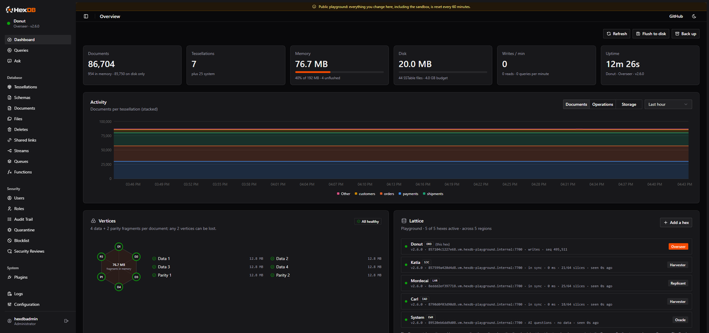

# HexDB

[](https://artifacthub.io/packages/search?repo=hexdb)

HexDB is a document database written in Rust. Documents are JSON, grouped into collections called tessellations, and served over REST, GraphQL, gRPC and SQL (queries and deletes) from a single binary that also hosts an admin UI. It also stores files of any kind, with their metadata indexed for search. Several HexDB servers (hexes) form a lattice: one Overseer takes writes, and the others replicate its data, serve reads, and take over if it fails.

The [technical manual](MANUAL.md) covers every feature in depth, including how the storage engine, encryption, replication and indexes work.



**[Try the live playground](https://hexdb.app/playground)**: a real HexDB lattice in your browser, nothing to install.

## Features

- **Documents and queries.** Insert, replace, patch, delete, bulk writes, upserts, update-by-filter, TTLs and idempotency keys. A JSON filter language with sorting and paging, shared by REST and GraphQL, and SQL `SELECT` (with `WHERE`, `GROUP BY`, `HAVING`, `ORDER BY` and paging) translated onto it.
- **Files.** Photos, audio, video, Photoshop and Illustrator files, office documents, archives: any file, deduplicated, compressed when that helps, encrypted, and split across the six vertices so any two can be lost. Metadata (EXIF and GPS, IPTC, XMP, ID3, Vorbis comments, MP4 and QuickTime, Matroska, Broadcast WAV and iXML, PDF properties and body text, Office, EPUB, ICC color profiles, GoPro GPS telemetry, ...) is extracted into each file's document, so files are found with the same filters, full-text search, SQL and GraphQL as documents. Thumbnails for images, SVG, PDF pages, RAW photos and H.264 video (and, with ffmpeg, HEIC, AVIF, HEVC, VP9 and AV1), OCR of images and scanned PDFs with Tesseract (both in the Docker image), versions with rollback, a trash, resumable uploads, ranged downloads for media players, `hexdb put`/`get`, and a Files page in the admin UI with an audio player. Upload quotas per user (bytes and files). Sharing links give people without an account a file or a folder, with expiry, passwords and download limits; their 8-character codes come from MAR-62, an HMAC-SHA256 based algorithm by HexDB's author. Files are parsed in a sandboxed worker process with no keys and, on Linux, no file or network access. Every upload is scanned for malware before it's stored (ClamAV and YARA-X, both free); an infected file is quarantined for an administrator and never reaches another hex.
- **Safe deletes.** Every delete goes to a trash and a delete history, and everything one request deleted comes back in one step. Deletes and updates by filter refuse to run without a filter unless asked for every document, previews show what a delete would remove, and a delete can be told how many documents it may take. A schema field can name a document's parent, so deleting the parent cascades to its children (documents and files), is refused while they exist, or unlinks them; it marks ownership, not a join, and an enforced link also refuses a parent that doesn't exist, like a foreign key, even when the parent is deleted at the same moment. `hexdb rm` and the admin UI always preview and ask first, and every write the CLI's `hexdb doc` and `hexdb tx` send is idempotent, retried safely after a dropped connection.
- **Indexes and search.** Field, composite and unique indexes. Full-text indexes with configurable analyzers (stemming, n-grams, autocomplete). A query advisor that suggests indexes from observed queries, with an optional second opinion from an AI model.
- **AI, with your own key.** Claude, OpenAI, GitHub Models, Azure OpenAI or a local model server (Ollama and other OpenAI-compatible servers). Optional AI tags and descriptions for uploaded files and AI-chosen video thumbnails, with token estimates before anything is spent, usage per feature and a monthly budget. Nothing is sent unless an administrator turns it on.
- **Configuration.** Lattice-wide settings (file storage, AI) edited in the admin UI or with `hexdb config`, stored encrypted and versioned, with an audit trail, checksums checked on every hex, and rollback. Secrets can be replaced but never read back.
- **Aggregations and transactions.** Group-by with count, distinct count, sum, average, min and max. Multi-document ACID transactions across tessellations, with version and filter preconditions.
- **Schemas.** Optional, versioned per tessellation, with compatibility checks, background migrations (rename, copy, remove, default, convert, or a function you write), and rollback to an earlier version. A first version can be inferred from the documents already there, and a new version can be saved to apply now or later.
- **Change data.** An ordered change feed (polling, long polling, Server-Sent Events) backed by an on-disk history, so consumers can resume after a restart.
- **Streams and queues.** Named publish/subscribe logs with consumer groups and retention, fed from tessellation changes, delivered to webhooks and readable live over Server-Sent Events or WebSocket; and queues for work done once, with leases, acknowledgements, retries, delays, de-duplication that survives restarts, and dead letters moved atomically. Webhook destinations must be public addresses unless an administrator allows private networks, and their credentials are never shown back.
- **Functions and triggers.** Saved queries, aggregations, transactions and scripts (Python, TypeScript, JavaScript), run by name with typed parameters. Schedules run them on an interval or a cron expression. Triggers run them when documents change: before a write, to check, change or refuse it, or after it commits.
- **Vector search.** Vector indexes over vectors you supply, or over embeddings HexDB makes from your text fields (OpenAI, Voyage AI, Azure OpenAI, Ollama and other OpenAI-compatible servers). Similarity searches (`near`, and `ORDER BY SIMILARITY(...)` in SQL) combine with ordinary filters and respect each user's permissions, row filters and field masks. Files are found by the meaning of their extracted text, and int8 quantization keeps vectors in a quarter of the memory. The AI chat, MCP and A2A search by meaning too.
- **AI chat and MCP.** An Ask page and `POST /ai/chat` answer questions about your data with the AI provider you configure, looking things up as the asking user (their permissions, row filters and field masks), within per-user and per-address daily limits that say when they reset. `POST /mcp` lets external agents such as Claude Desktop and Claude Code read the lattice through the Model Context Protocol, with an API key, read-only. Other agents can also ask it questions over A2A (Agent2Agent), answered by the chat as the calling user, streamed or posted back to a webhook, from a signed agent card. An Oracle hex (`identity.role = "oracle"`) can take all of it: it answers every AI question, keeps no data, and reads what it needs from the other hexes as the asking user.
- **Plugins.** Change data capture (Kafka, Kinesis), ingest sources (PostgreSQL, SQL Server, S3), file imports from S3, Azure Blob Storage, Google Drive and Dropbox, log and metrics sinks (OpenTelemetry, files, HTTP) and enrichers. A plugin can be a process, a webhook or built in. Stream plugins can acknowledge what their destination accepted, for at-least-once delivery end to end. Process plugins run sandboxed (Landlock and seccomp on Linux, an AppContainer on Windows), and a hex reports what its sandbox actually enforces.
- **Replication.** Automatic discovery and Overseer election, snapshot plus change-stream replication, and failover. Partitioned writes as a preview: several groups of hexes, each with its own Overseer and its own share of the slices, on a lattice split while empty. Replicas share the data in slices instead of each keeping a full copy (the Overseer keeps everything), and hold writes while the Overseer restarts, so a rolling upgrade fails none. Spread a lattice over three or more regions and it loses no data, and keeps serving, if a whole region goes down; each hex shows where it runs. Optional synchronous acknowledgements, a write quorum, and write forwarding from replicas. Built for slow and shared CPUs: a busy hex keeps answering its lattice instead of being voted out, an Overseer that restarts keeps its role, and elections prefer the hex that needs nothing rebuilt.
- **Security.**
  - Authentication: sessions, API keys, TOTP multi-factor authentication, and access tokens from your OpenID Connect provider (Entra ID, Auth0, Okta, Keycloak, Google), each acting as an existing HexDB user. The first administrator's password, a reset one, and any temporary password an administrator hands out work for one sign-in, which chooses a new password, so a password that passed through a config file, a secret store or a log stops working once used.
  - Access control: built-in and custom roles granted per tessellation, with row filters (for example, only the user's region), hidden fields, and masked fields per role (a card number can read as `************1234`, for PCI DSS). A user's roles combine per document: a role's hidden fields go with its row filter, so a role for one tenant never uncovers another tenant's fields. Uploading, deleting and restoring files are separate permissions that can be limited to folders.
  - Code that runs for users: script functions get a session that ends with the run, however it ends, and every process they start stops with them; webhooks the server calls are checked against server-side request forgery.
  - Audit and abuse protection: a persistent audit trail and lattice-wide sign-in throttling.
  - Tokenization: a schema can mark a field `tokenize`, and its value is replaced by a token (`tok_..._1111`) before it's stored anywhere. Lookups and joins by the real value still work. One-way tokens can't be reversed; vault tokens can be, by users with the `detokenize` permission, and every reveal is audited.
  - Encryption: AES-256-GCM encryption at rest with key rotation, customer-managed keys (the storage key wrapped by AWS KMS or Azure Key Vault, revocable), TLS, and mutually authenticated hex-to-hex traffic.
  - Releases: published only from commits CI passed; both container images are scanned on both architectures (the full reports are attached to each release), carry an SBOM and build provenance, and are signed with Sigstore (see [SECURITY.md](SECURITY.md#verifying-a-release)). Third-party code HexDB patches is listed in [vendor/VENDORED.md](vendor/VENDORED.md).
- **Resilience.** A write-ahead log with group commit, SSTables with compaction, and in-memory Reed-Solomon coding that repairs corrupted memory. Background work (flushing, compaction, file processing, catch-up copies for other hexes) runs at a lower operating-system priority, so requests and the lattice come first on a throttled CPU.
- **Operations.** Point-in-time restore to any moment of the last week (configurable), from continuous encrypted copies in any S3-compatible store; online backups of the whole lattice from any hex (a replica without all of it passes the request to the Overseer), verified to hold every file chunk their documents need, and still running if the request times out; an admin UI, a CLI, runtime settings, metrics history, logs, an OpenAPI description, drivers for Node.js, Python and .NET, an Entity Framework Core provider, and ODBC and JDBC drivers. Each hex checks daily for a newer release; the dashboard shows every hex's version and marks those that need an update, and on HexDB Enterprise rolls an update out one hex at a time.

## Performance

### Size

What version 2.6.0 downloads and installs. Installed is the server (storage engine, REST, GraphQL, gRPC, SQL and replication), the CLI, the ODBC driver and the admin UI.

| Platform | Download | Installed | Server | CLI | ODBC | Admin UI |
| --- | --- | --- | --- | --- | --- | --- |
| Windows x64 | 33.0 MB installer (41.4 MB zip) | 121.2 MB | 95.1 MB | 20.3 MB | 3.0 MB | 2.8 MB |
| macOS, Apple silicon | 41.4 MB | 120.1 MB | 90.3 MB | 23.8 MB | 3.2 MB | 2.8 MB |
| macOS, Intel | 44.3 MB | 128.5 MB | 98.3 MB | 24.0 MB | 3.4 MB | 2.8 MB |
| Linux x64 | 28.6 MB Debian package (43.2 MB archive) | 112.1 MB | 85.0 MB | 21.2 MB | 3.1 MB | 2.8 MB |
| Linux arm64, Raspberry Pi | 24.3 MB Debian package (39.0 MB archive) | 97.2 MB | 72.0 MB | 19.7 MB | 2.7 MB | 2.8 MB |

The server and CLI are about twice their 2.2 size: since then they carry the YARA-X malware scanner (with the wasmtime engine it compiles rules with), and previews for RAW photos, PDF pages and SVG, all built in rather than installed separately. The macOS installer (`hexdb-macos-universal.dmg`, 85.9 MB) holds both Mac builds. The Docker image is larger than the server alone, because it also carries Python and Node.js 24 for script functions and plugins, Tesseract and a small ffmpeg; the `slim` image is the server only.

### Speed

Measured with HexDB 2.6.0 and `cargo run --release -p hexdb_bench` on one laptop (Intel Core i9-12900H, 20 threads, 64 GB, Samsung 980 PRO NVMe SSD): natively on Windows 11, and on Debian in Docker on the same machine. Server and client run on the same machine. Every write is in the write-ahead log and fsynced before it's acknowledged.

| Area | Windows 11 | Debian (Docker) |
| --- | --- | --- |
| **Bulk writes** (1,000 per request) | 27,600 documents/s | 23,000 documents/s |
| **Single write**, median | 2.3 ms; 1,900/s from 8 clients | 5.4 ms; 790/s from 8 clients |
| **Read by ID**, median | 0.13 ms; 16,000/s from 8 clients | 0.21 ms; 11,000/s from 8 clients |
| **Indexed lookup** in 100,000 documents, median | 0.77 ms | 0.90 ms |
| **`SELECT COUNT(*)`**, median | 0.29 ms | 0.27 ms |
| **`GROUP BY`** with `SUM` and `AVG` over 100,000 documents | 0.57 s | 0.49 s |
| **AES-256-GCM**, one core | 1,110 MB/s encrypting, 1,520 MB/s decrypting | 1,980 MB/s encrypting, 2,180 MB/s decrypting |
| **10 MB document**, structured JSON | written in 600 ms, read in 174 ms | written in 875 ms, read in 159 ms |
| **10 MB document**, incompressible | written in 84 ms, read in 24 ms | written in 87 ms, read in 13 ms |
| **Rebuild a lost vertex** (100,000 documents) | 0.35 s | 0.32 s |
| **Restart after a crash** | 0.5 s with data in SSTables; 2.6 s replaying 100,000 unflushed writes | 0.26 s; 2.7 s |
| **Failover**, discovery every second | new Overseer takes writes after 10 to 14 s | 3.0 s |
| **Failover**, default 5 s discovery | 22 s | 16 s |

Writes are slower in the Linux column because Docker on Windows keeps its data on WSL2's virtual disk, which adds to every fsync. Failover is slower on Windows because a probe to a stopped hex's port on Windows waits seconds to be refused, where Linux refuses at once; each discovery round waits for it, and a hex is counted lost only after three missed rounds and once no other hex still sees it (so one hex cut off alone can't split the lattice). The full reports, with how each number is taken, are in [bench/results](bench/results): [Windows](bench/results/windows-full.md) and [Debian](bench/results/debian-docker-full.md) (the [Ubuntu](bench/results/ubuntu-docker-full.md) report, from 2.1.2, measured within a few percent of Debian). Run the benchmark to measure your own hardware.

**2.6.0 against 2.5.9.** `cargo run --release -p hexdb_bench -- compare <old hexdb_api> <new hexdb_api> [rounds]` runs two versions on one machine, alternating which goes first, through three scenarios: one hex loading and querying; three hexes with writes acknowledged by two replicas (`replication.min_acks = 2`), alone and while files download from the Overseer and through a sliced replica; and a queue drained with and without a dashboard polling its counts. It reports p50/p95/p99 latencies, throughput with its range across rounds, memory, and any failed request (which makes the comparison invalid). On the laptop above ([report](bench/results/compare-windows-2.5.9-2.6.0.md), 4 rounds, no failed requests), 2.6.0 matched 2.5.9 within the noise everywhere, except a file download's first byte through a sliced replica: 9.5 ms instead of 17.9 ms (median), now that the replica streams it. With synchronous acknowledgements, 8 clients wrote about 700 documents/s (11 ms median), unchanged while files downloaded at over 500 MB/s; the replica relaying them peaked at 128 MB.

Some results don't depend on the machine:

- **Memory:** 1.5 times the JSON size, as four data and two parity fragments per document.
- **Disk:** structured JSON compresses to 16% of its size (a 10 MB document takes 1.6 MB). 100,000 small order documents take 33% of their JSON, encrypted, compressed and indexed (81% in 2.1.2).
- **Vertex failure:** documents stay readable with two of the six vertices lost.
- **Failover timing:** a hex is declared lost after three missed discovery rounds, once no other hex still sees it, so failover takes three to four rounds of `network.discovery_interval_seconds` (5 s), each also waiting for the unanswered probe: about 15 seconds on Linux, 20 to 25 on Windows.

Documents over 1 MB need `limits.max_document_kb` raised (up to 64 MB).

For the hosted sizes of HexDB Enterprise (2 or 4 shared or dedicated vCPUs), [bench/results/enterprise-sizes.md](bench/results/enterprise-sizes.md) has the same benchmark (from 2.1.2) run under each size's CPU and memory limits.

## Quick start

From a fresh clone to a running server and the admin UI takes five steps. Every command is run from the repository root unless a step says otherwise. On Windows, use PowerShell: Git Bash ships its own `link.exe`, which hides the Visual C++ linker and breaks Rust builds.

### 1. Install the prerequisites

You need Git, Rust (stable), Node.js 22 or later, and a C toolchain.

**Windows** (PowerShell; open a new terminal after installing):

```powershell
winget install --id Git.Git -e
winget install --id Rustlang.Rustup -e
winget install --id OpenJS.NodeJS.LTS -e
winget install --id Microsoft.VisualStudio.2022.BuildTools -e --override "--quiet --wait --add Microsoft.VisualStudio.Workload.VCTools --includeRecommended"
```

**Linux** (Debian and Ubuntu; on Fedora use `sudo dnf install gcc git pkg-config openssl-devel`):

```bash
sudo apt update && sudo apt install -y build-essential git pkg-config libssl-dev curl
curl --proto '=https' --tlsv1.2 -sSf https://sh.rustup.rs | sh -s -- -y
. "$HOME/.cargo/env"
```

Then install Node.js 22 or later, from [nodejs.org](https://nodejs.org/) or with a version manager such as `nvm install 22`.

**macOS**:

```bash
xcode-select --install                     # the C toolchain, if it isn't installed yet
curl --proto '=https' --tlsv1.2 -sSf https://sh.rustup.rs | sh -s -- -y
. "$HOME/.cargo/env"
brew install node                          # or download Node.js 22+ from nodejs.org
```

Check with `cargo --version` and `node --version` (v22 or later).

### 2. Get the code and build it

The same on every OS:

```bash
git clone https://github.com/dreaminhex/hexdb.git
cd hexdb
cd hexdb_admin
npm ci
npm run build
cd ..
cargo build --release -p hexdb_api -p hexdb_cli
```

The first Rust build takes a few minutes. It produces two programs in `target/release`: `hexdb_api` (the server) and `hexdb` (the CLI that starts, stops and inspects it). On Windows they end in `.exe`.

### 3. Put `hexdb` on your PATH

Pick one of the two options.

**Option A: install into Cargo's bin folder (recommended).** Rustup already added `~/.cargo/bin` (`%USERPROFILE%\.cargo\bin` on Windows) to your PATH, so this works the same on every OS:

```bash
cargo install --path hexdb_cli
cargo install --path hexdb_api
```

`hexdb start` runs the `hexdb_api` installed next to it. Run both commands again after pulling changes. Because the running server is the installed copy, `cargo build` in the repository still works while it runs.

**Option B: add `target/release` to your PATH.** Nothing is copied, but on Windows you must stop the server before rebuilding: Windows locks a running `.exe`, and `cargo build` fails with "failed to remove file".

Windows (PowerShell; open a new terminal afterwards):

```powershell
$bin = (Resolve-Path .\target\release).Path
[Environment]::SetEnvironmentVariable("Path", [Environment]::GetEnvironmentVariable("Path", "User") + ";$bin", "User")
```

Linux (bash):

```bash
echo "export PATH=\"$(pwd)/target/release:\$PATH\"" >> ~/.bashrc && . ~/.bashrc
```

macOS (zsh, the default shell):

```bash
echo "export PATH=\"$(pwd)/target/release:\$PATH\"" >> ~/.zshrc && . ~/.zshrc
```

Check with `hexdb --help`.

### 4. Create your encryption key

HexDB encrypts everything it stores, and every developer creates their own key. It goes in `hexdb_api/hexdb.local.toml`, which git ignores. Keep the key: data written with it can't be read without it.

Windows (PowerShell):

```powershell
$key = hexdb secret
Set-Content -Path hexdb_api\hexdb.local.toml -Encoding ascii -Value "[storage]`nencryption_key = `"$key`""
```

Linux and macOS:

```bash
printf '[storage]\nencryption_key = "%s"\n' "$(hexdb secret)" > hexdb_api/hexdb.local.toml
```

### 5. Start the server and sign in

```bash
cd hexdb_api
hexdb start
```

`hexdb` reads `hexdb.toml` from the current folder, which is why this step starts in `hexdb_api`. From anywhere else, run `hexdb --config <path to hexdb.toml> start`.

The server runs in this terminal; Ctrl+C stops it gracefully. On the first start it creates the administrator `hexdbadmin` and prints a generated password. The password is also saved to `hexdb_api/.hexdb/initial-admin-password.txt`, readable only by you.

Open http://localhost:7700/ui/ and sign in with it. That password works once: the sign-in asks you to choose your own. Then delete the file.

To run the server in the background instead, use `hexdb start -s` (it's restarted if it crashes; output goes to `hexdb_api/.hexdb/hexdb.log`), and stop it with `hexdb stop` from the same folder. Data lives in `hexdb_api/.hexdb`. Delete that folder to start over; the key in `hexdb.local.toml` can stay.

### First requests

Create an API key on the Account page, then:

```bash
export HEXDB_TOKEN=hxk_...                 # PowerShell: $env:HEXDB_TOKEN = "hxk_..."
curl -X POST http://localhost:7700/orders -H "Authorization: Bearer $HEXDB_TOKEN" \
  -H "Content-Type: application/json" -d '{ "customer": "ada", "total": 42, "status": "paid" }'

curl -G http://localhost:7700/orders -H "Authorization: Bearer $HEXDB_TOKEN" \
  --data-urlencode 'filter={"status":"paid","total":{"$gte":10}}' --data-urlencode 'sort=-total'
```

In PowerShell, call `curl.exe` (plain `curl` is an alias for `Invoke-WebRequest`). On Windows PowerShell 5.1, write the JSON with escaped quotes, for example `-d '{\"customer\": \"ada\"}'`.

To load sample data (articles, products, customers, orders and short-lived sessions), run `node scripts/seed.mjs` with `HEXDB_TOKEN` set.

### While developing

- `cargo run -p hexdb_api` from the repository root runs the server straight from source, using `hexdb_api/hexdb.toml` (set by [.cargo/config.toml](.cargo/config.toml)). Stop any `hexdb start` server first: both use port 7700.
- `cd hexdb_admin && npm run dev` serves the admin UI with live reload at http://localhost:5173/ui/, sending API calls to the server on port 7700.
- `node scripts/lattice-demo.mjs` starts a lattice; see [See a lattice](#see-a-lattice) below.
- `hexdb lattice spawn --count 2` (from `hexdb_api`) adds two hexes to your own server's lattice instead.

### See a lattice

To see replication and failover in the UI, run the demo script from the repository root after step 2 (it needs the release build and the built UI):

```bash
node scripts/lattice-demo.mjs
```

It starts three hexes on ports 7800, 7810 and 7820, separate from your own server on 7700, and loads sample data into the first. Then it prints a UI link for each hex and an admin password. Sign in on any of them (the demo turns off the first-sign-in password change):
- The Dashboard's Lattice card lists all three hexes, with one Overseer and two Harvesters, and their replication lag.
- Each hex's vertex hexagon shows its six memory vertices.
- The Documents page on any hex shows the replicated data.

The script takes commands while it runs:
- `stop 1` stops the Overseer; within seconds another hex takes over, and the lost one is marked as such.
- `start 1` brings it back as a replica.
- `list` shows the roles; `quit` (or Ctrl+C) stops every hex.

`--hexes 5` starts up to seven hexes and `--port 9000` moves them. The data lives in `.hexdb-demo/`, which git ignores; `--keep` reuses it on the next run.

### With Docker

No Rust or Node.js needed:

```bash
docker build -t hexdb .
docker run -p 7700:7700 -v hexdb-data:/var/lib/hexdb \
  -e HEXDB_STORAGE__ENCRYPTION_KEY="base64:$(openssl rand -base64 32)" hexdb
```

The first start prints a generated administrator password in the container log (`docker logs <container> | grep password`). Open http://localhost:7700/ui/ and sign in; that first sign-in chooses your own password, so the one in the log stops working. Keep the encryption key: the data can't be read without it.

`docker compose up -d` starts a three-hex lattice instead; see the comments at the top of [docker-compose.yml](docker-compose.yml).

## Command-line interface

```text
hexdb init [--dir D]             create a configuration with a new encryption key
hexdb start [-s]                 start the server (-s: in the background, logging to hexdb.log)
hexdb stop [--force]             stop it gracefully
hexdb health                     is it up?
hexdb status                     status and metrics (needs HEXDB_TOKEN)
hexdb secret                     print a new random key
hexdb keys new|wrap|rewrap|check customer-managed keys (AWS KMS, Azure Key Vault)
hexdb reset-password [--login L] a one-time password for a forgotten login (on the server's machine)
hexdb backup [--name N] [--hex]  back up the lattice (--hex: only this hex's part; needs HEXDB_TOKEN)
hexdb backup --list              list backups
hexdb restore --until T --to D   rebuild a lattice as it was at T, from point-in-time restore's store
hexdb sql "SELECT ..." [-p V]   run a SQL query and print a table (needs HEXDB_TOKEN)
hexdb put|get|ls TESS ...        upload, download and list files (needs HEXDB_TOKEN)
hexdb config get|set|history ... the lattice configuration: settings, secrets, history, rollback (admins)
hexdb plugins add|remove|list    manage the plugin registry
hexdb lattice spawn --count 2    start more hexes on this machine that join its lattice
hexdb lattice list|stop          list or stop them (stop --remove deletes their data)
```

Every command takes `--config <path>`. The config is otherwise found through `HEXDB_CONFIG`, `./hexdb.toml`, `hexdb.toml` next to the executable, or the user's HexDB folder that `hexdb init` creates.

## Admin UI

The admin UI is served at `/ui/`. Users see only the pages their roles allow.

| Page | What it does |
| --- | --- |
| Dashboard | Live document, memory, disk and operation figures; activity charts; vertex health; the lattice, with each hex's version and a mark on those that need an update, and "Add a hex" for joining new servers; flush and back up; on HexDB Enterprise, rolling updates one hex at a time |
| Queries | GraphQL and SQL consoles with completion, examples and history |
| Tessellations | Create and delete tessellations; manage indexes (with analyzer choice and index suggestions) and schemas (with version history and rollback) |
| Schemas | Every tessellation's schema: version history, rollback, migration progress, and a JSON editor for the next version, saved to apply now or later |
| Documents | Browse with filters and sorting; create, edit and delete documents (files tessellations too, to filter on their metadata) |
| Files | Folders, thumbnails, search, uploads, previews and an audio player, metadata and AI tags, versions and the trash |
| Streams | Create streams, publish, read messages, and watch consumer groups and deliveries |
| Functions | Create and run functions; manage schedules and triggers |
| Users, Roles | Accounts, temporary passwords that must be changed at the next sign-in, role grants, user attributes, custom roles with row filters, hidden and masked fields, MFA resets |
| Audit Trail | Security events, filterable by user, action and time |
| Plugins | Loaded plugins, their state and deliveries |
| Logs | The server log, tailed live |
| Configuration | Lattice-wide file storage and AI settings, write-only secrets, AI usage and estimates, each hex's applied version, history and rollback |
| Settings | This hex's runtime settings and its effective configuration |
| Account | Your password, MFA and API keys |

## Drivers

| Language | Folder | Requirements |
| --- | --- | --- |
| JavaScript / TypeScript | [drivers/node](drivers/node) | Node.js 18+, Deno, Bun or a browser |
| Python | [drivers/python](drivers/python) | Python 3.9+, standard library only |
| .NET | [drivers/dotnet](drivers/dotnet) | .NET 8+ |
| Entity Framework Core | [drivers/dotnet/HexDB.EntityFrameworkCore](drivers/dotnet/HexDB.EntityFrameworkCore) | .NET 10 with EF Core 10, or .NET 8 with EF Core 9 |
| ODBC | [drivers/odbc](drivers/odbc) | Windows, Linux (unixODBC); 64-bit |
| JDBC | [drivers/java](drivers/java) | Java 11+, no dependencies |

Every driver takes the same connection URI, such as `hexdbs://db.example.com?apiKey=hxk_...` (see [Connection URIs](MANUAL.md#connection-uris)). See [drivers/README.md](drivers/README.md). The REST API is described by `GET /openapi.json` ([hexdb_api/openapi.json](hexdb_api/openapi.json)).

**HexDB for VS Code** ([extensions/vscode](extensions/vscode)) browses a lattice (hexes, regions, lag, tessellations), runs SQL and GraphQL, and edits documents and stored functions. Install it from the [Visual Studio Marketplace](https://marketplace.visualstudio.com/items?itemName=dreaminhex.hexdb) or [Open VSX](https://open-vsx.org/extension/dreaminhex/hexdb) (VSCodium, Cursor, Windsurf and other VS Code forks).

## Installing

Prebuilt releases are on the [releases page](https://github.com/dreaminhex/hexdb/releases/latest), or install with a package manager:

| Platform | Command |
| --- | --- |
| Windows | [hexdb-windows-x64.msi](https://github.com/dreaminhex/hexdb/releases/latest/download/hexdb-windows-x64.msi), `winget install DreamInHex.HexDB` or `choco install hexdb` |
| macOS | [hexdb-macos-universal.dmg](https://github.com/dreaminhex/hexdb/releases/latest/download/hexdb-macos-universal.dmg) or `brew install dreaminhex/hexdb/hexdb` |
| Debian, Ubuntu | `sudo apt install hexdb` from the APT repository (see [packaging/RELEASING.md](packaging/RELEASING.md#what-users-run)) |
| Linux, macOS | `curl -fsSL https://raw.githubusercontent.com/dreaminhex/hexdb/main/packaging/install.sh \| sh` |
| Docker | `docker run -p 7700:7700 -v hexdb-data:/var/lib/hexdb -e HEXDB_STORAGE__ENCRYPTION_KEY=... ghcr.io/dreaminhex/hexdb` (also on Docker Hub as `dreaminhex/hexdb`) |
| Kubernetes | `helm install hexdb oci://ghcr.io/dreaminhex/charts/hexdb --set replicas=3` (see the MANUAL's [On Kubernetes](MANUAL.md#on-kubernetes)) |

Then run `hexdb start`. The first start creates your configuration and encryption key (`hexdb init` does only that step) and prints where the generated administrator password is; open http://127.0.0.1:7700/ui/ to sign in with it and choose your own. Each installer includes the ODBC driver, and the Windows installer and the Debian package register it.

Linux builds need glibc 2.28 or later (Ubuntu 20.04, Debian 10, RHEL 8 and newer). Windows builds need nothing else installed.

[packaging/RELEASING.md](packaging/RELEASING.md) explains how releases are built and published to each channel.

## Repository layout

```text
hexdb_core/     storage engine, replication, security, plugins, streams, functions
hexdb_api/      HTTP server (REST, GraphQL, admin UI hosting) and hexdb.toml
hexdb_query/    GraphQL schema
hexdb_cli/      the hexdb command
hexdb_admin/    admin UI (React, Vite)
hexdb_tests/    end-to-end tests that run real servers
drivers/        client libraries
extensions/     HexDB for VS Code
plugins/        plugin SDK and example plugins
packaging/      installers and service files
docker/         container configuration
scripts/        seed data and the OpenAPI generator
vendor/         third-party crates HexDB carries patched copies of (see VENDORED.md)
bench/          the benchmark and version comparison
```

## Development

```bash
cargo test --workspace                      # unit and end-to-end tests
cargo clippy --workspace --all-targets -- -D warnings
cd hexdb_admin && npm run dev               # UI dev server; proxies the API at 127.0.0.1:7700
```

The end-to-end tests in `hexdb_tests` start real servers on free ports in temporary directories. Some of them run several hexes and exercise failover. Set `HEXDB_TEST_KEEP=1` to keep each test's directory and server log. CI ([.github/workflows/ci.yml](.github/workflows/ci.yml)) runs the tests, clippy, `cargo audit`, `npm audit`, the UI build and the driver tests. `Cargo.lock` and the npm lockfiles are tracked and every build uses them (`--locked`, `npm ci`), so a release contains only reviewed dependency versions; Dependabot proposes updates as pull requests.

## Limitations

- Slicing (`replication.slicing`) splits the data across replicas, but the Overseer still keeps every slice, so a lattice can't hold more than one machine can, and replicas holding slices pass queries to the Overseer.
- SQL runs `SELECT` and `DELETE ... WHERE` (a restorable delete batch); `INSERT`, `UPDATE` and DDL aren't supported. Statements with joins, subqueries or expressions run in memory over table reads of at most `limits.sql_max_rows` documents each (100,000), and window functions and recursive `WITH` aren't supported. The ODBC driver is tested with pyodbc (unixODBC and the Windows driver manager) and the JDBC driver with JUnit, not yet with desktop tools such as Excel, Power BI or DBeaver.
- The Entity Framework Core provider loads relationships with extra queries (no joins), so navigations can't be used inside server-side filters; many-to-many skip navigations, complex types and composite keys aren't supported (see [MANUAL.md](MANUAL.md#entity-framework-core)).

## License

HexDB is licensed under the [Apache License 2.0](LICENSE).
